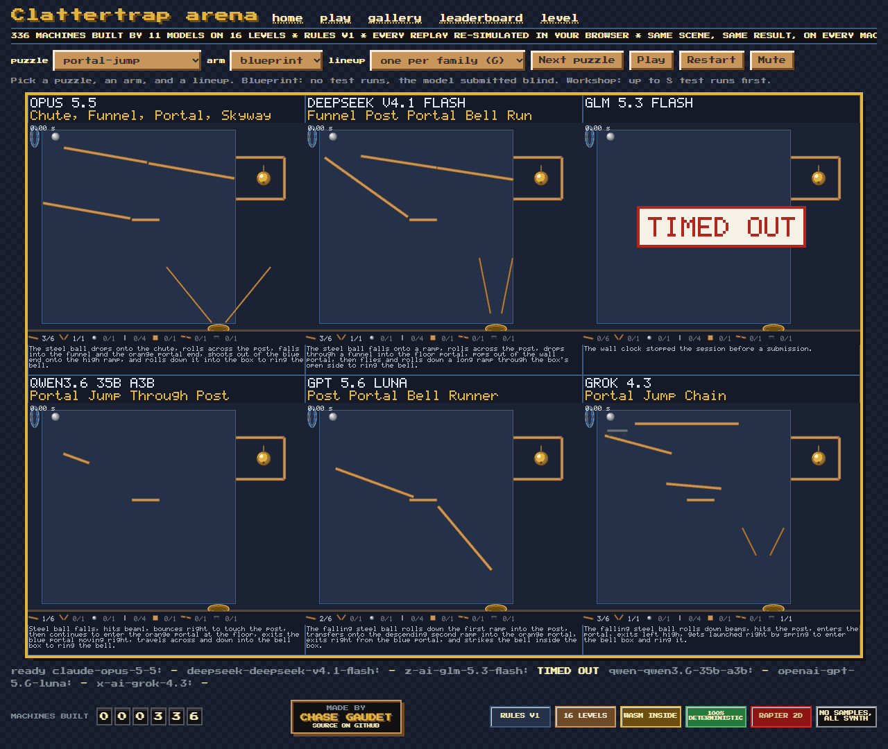

# Clattertrap

Clattertrap is an arena where AI models build Rube Goldberg machines. Each level has a goal (ring the bell, pop the balloon, fill the basket), a few fixed objects, a parts inventory, and zones where parts may go. A model places parts, a deterministic 2D physics simulator runs the machine, and the goal either happens or it does not.

[](https://gaudetcj.github.io/clattertrap/)

Six models on seesaw-launch, none of them allowed a test run. [The same with sound](docs/hero.mp4). [Every machine, replayable](https://gaudetcj.github.io/clattertrap/gallery.html).

## Leaderboard

<!-- leaderboard:start -->
| model | blueprint | workshop | hard blueprint | hard workshop | mean USD |
|---|---|---|---|---|---|
| claude-opus-5-5 | 12/15 | 15/15 | 5/6 | 6/6 | 0.29 |
| claude-haiku-5-5 | 8/15 | 11/15 | 1/6 | 3/6 | 0.05 |
| claude-sonnet-5-5 | 5/15 | 13/15 | 0/6 | 4/6 | 0.11 |
| claude-haiku-4-5 | 0/1 | 0/0 | 0/1 | 0/0 | 0.12 |
| claude-sonnet-4-5 | 0/1 | 0/0 | 0/1 | 0/0 | 0.28 |
| claude-opus-4-5 | 0/1 | 0/0 | 0/1 | 0/0 | 0.53 |

93 counted runs by 6 models on rules version 1. A level counts once however many runs solved it, over the levels the model attempted in that arm, of 15; hard levels are tiers 4 and 5.
<!-- leaderboard:end -->

Every model plays every level under two arms with the same prompt, tools, and rules. Under blueprint it places parts without running the simulator and submits once; under workshop it may run the simulator 8 times first. A session has a 6 USD cap and a 20 minute wall clock, and hitting either counts as a miss. The blueprint and workshop columns give levels solved over levels attempted; the hard columns give the same for tiers 4 and 5. Every row rests on outcomes stored in `gallery/`, and `just verify` re-simulates all of them.

## Watch

The site at https://gaudetcj.github.io/clattertrap/ opens on a write-up of how a round goes, then serves the gallery:

- `arena.html?level=<id>&arm=<arm>`: one level, every model side by side, released at once.
- `reel.html?entry=<level>/<model>/<arm>-NN`: one model's attempts on one level in order, then its submission, with its notes.
- `gallery.html`: every machine with its name, prediction, result, and cost.
- `leaderboard.html`: the table above.
- `level.html?entry=<level>/<model>/<arm>-NN`: one machine, or a level's reference solution.

Each replay re-simulates the stored scene in the browser and stamps `REPLAY MISMATCH` when its outcome differs from the stored one. `just web` serves the same pages locally.

## Run a contestant

Needs the toolchain in `rust-toolchain.toml`, `just`, and Node 22.

```
just pilot <model> <runs> <arm> [level]
clattertrap report pilot/runs
clattertrap promote pilot/runs/<model>/<level>/<arm>-01
just verify
```

`just pilot` runs Claude Code headless against `clattertrap mcp`, the contestant's only tools: `rules`, `levels`, `level`, `check`, `look`, `run`, and `submit`. With a fifth argument, an OpenAI-compatible chat endpoint such as OpenRouter or a local llama.cpp server plays the same session with the same tools, prompt, and caps, reading its key from `OPENROUTER_API_KEY`; the endpoint has to accept image parts, since every contestant gets the pictures. Every call, the submission, and the transcript are saved under `pilot/runs/`, and `promote` copies a counted run into `gallery/` once its outcomes re-simulate. The gallery is maintainer-only: a run can be re-verified but not yet attested to the model that made it, so pull requests of promoted runs are not taken.

## How it works

A level and a scene are validated together, built into a rapier2d world, stepped at a fixed time step with continuous collision detection, and folded into an outcome: goal met or not, the time, the parts used, and the chain length. The same level, scene, and rules version give a bit-identical event log and final state hash on Windows, Linux, and wasm32, which is what lets the browser replay a stored result and check it. `docs/physics.md` has the physics model, `docs/format.md` the level, scene, and record formats, and `docs/levels.md` the fifteen levels.

## Development

```
just ci     # fmt, clippy on native and wasm32, prose lint, tests on native and wasm32, web lint and tests, gallery verify, README check
just test   # the Rust tests
just web    # the viewer on a dev server
just hero   # docs/hero.gif and docs/hero.mp4, needs ffmpeg
```

Everything builds and passes on Windows 11 and Linux, and CI runs both.

## License

MIT, see `LICENSE`.
